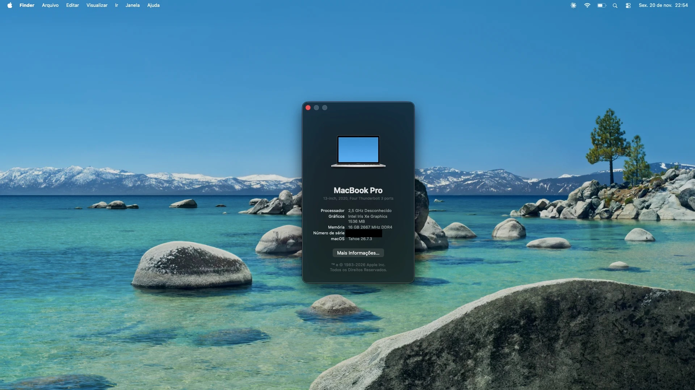

# macOS Tahoe on the Dell Inspiron 15 3520 (i5-1235U, Iris Xe)

**English** · [Português](README.pt-BR.md)

OpenCore build scripts and notes for running macOS Tahoe 26 on the Dell Inspiron 15 3520 with
an Intel Core i5-1235U (Alder Lake-U, Iris Xe `8086:46a8`). It covers graphics acceleration,
Wi-Fi, Bluetooth, audio, keyboard, touchpad and HDMI.

The repository contains no binaries. A script downloads every component from its official source
at a pinned version and checks its SHA-256 (see [`components.lock`](components.lock)). A second
script builds the EFI folder from those files.



*About This Mac on the tested laptop. The serial number is generated by OpenCore and is hidden
here. "Unknown" next to the processor is cosmetic: macOS has no name for this CPU.*

> [!WARNING]
> This is an experimental setup, tested on **one** laptop. Several parts rely on drivers that
> their own authors call experimental. Back up your data before you start.

## Status

Tested on macOS Tahoe 26.7.3 (25G342), OpenCore 1.0.8, Dell BIOS 1.30.0.

| Component | Hardware | Solution | Status |
|---|---|---|---|
| CPU | i5-1235U (2P + 8E cores) | CpuTopologyRebuild, CPUID emulation | ✅ |
| Graphics | Iris Xe 80 EU `8086:46a8` | WhateverXe 0.8.3 + WhateverXe-Graphics 0.4.4 + AMFIAnchor | ✅ Metal 2, 1536 MB, 1080p internal panel |
| Brightness | eDP backlight | `SSDT-PNLF` under the iGPU + BrightnessKeys | ⚠️ Control Center slider works; Fn+F6/F7 do not |
| HDMI | Native HDMI port | WhateverXe + EDID override ([`edid-force-rgb.py`](scripts/edid-force-rgb.py)) | ✅ 1080p60 on a TV (needed the override) |
| Audio | Cirrus Logic CS8409 `1013:8409` | CS8409Audio 1.1.0 | ✅ speakers and microphone · ❌ headphone jack |
| Wi-Fi | Realtek RTL8821CE `10ec:c821` | RTL88WiFi | ✅ WPA2 · ❌ AirDrop, Continuity, WPA3-only |
| Bluetooth | Realtek USB `0bda:c829` | RealtekBluetoothFirmware 1.0.2 + patch, BlueToolFixup | ✅ headset paired (A2DP, HFP, AVRCP) |
| Keyboard | PS/2, ABNT2 (ISO) | VoodooPS2 with ISO layout | ✅ volume and mute keys work |
| Touchpad | Goodix I2C `27C6:0D43` | VoodooI2C (master build) + VoodooI2CHID | ✅ |
| Storage | ADATA NVMe | NVMeFix | ✅ |
| Battery | Dell PG8YJ3A | SMCBatteryManager, ECEnabler | ✅ charge level, discharge, health |
| USB | — | USBToolBox + Inspiron 3520 port map | ✅ |
| Sleep, webcam | — | — | ❓ not tested yet |

The full list of what was changed, and why, is in [docs/NOTES.md](docs/NOTES.md).

## Quick start

You need a Mac, Linux or another machine with `bash`, `curl`, `git`, `unzip` and `python3`, and a
USB stick of 4 GB or more.

```bash
git clone https://github.com/lucaseduardo1656/dell-inspiron-3520-hackintosh
cd dell-inspiron-3520-hackintosh
scripts/fetch-components.sh --recovery   # components + macOS Tahoe recovery (~1 GB)
VERBOSE_BOOT=1 python3 scripts/build-efi.py
```

Then follow [docs/INSTALL.md](docs/INSTALL.md): BIOS settings, the USB installer, the
installation and the steps inside macOS. If something fails, see
[docs/TROUBLESHOOTING.md](docs/TROUBLESHOOTING.md).

## Repository layout

| Path | Contents |
|---|---|
| `components.lock` | every downloaded component: source, version, SHA-256 |
| `scripts/fetch-components.sh` | downloads and verifies the components into `downloads/` |
| `scripts/build-efi.py` | builds `build/EFI` and documents each change to the template |
| `scripts/build-bluetooth.sh` | builds the patched Bluetooth kext (macOS only) |
| `scripts/make-usb-linux.sh` | writes the USB installer from Linux |
| `scripts/edid-force-rgb.py` | EDID override for HDMI TVs/monitors with wrong colours |
| `docs/` | installation guide, troubleshooting, technical notes |

`downloads/`, `build/` and `private/` are created locally and are not part of the repository.
`private/smbios.plist` holds your generated serial number: keep it, and never publish it.

## Credits

This setup exists because of other people's work. The configuration starts from the template,
ACPI tables, USB map and Bluetooth patch that
[pedrovrs301-gif](https://github.com/pedrovrs301-gif/dell-inspiron-3520-i5-1235u-sequoia)
published for this same laptop on Sequoia. The brightness fix comes from
[Aniket601](https://github.com/Aniket601/AlderLake-IrisXe-OpenCore)'s IdeaPad 3 build, and the
graphics support from [b00t0x](https://github.com/b00t0x/WhateverXe)'s WhateverXe.
[CREDITS.md](CREDITS.md) lists every project, the license of each one, and the issue threads
that helped solve specific problems.

## License

The scripts and documentation in this repository are under the [MIT License](LICENSE). The
components they download keep their own licenses (see [CREDITS.md](CREDITS.md)).

## About this documentation

The documentation in this repository was written with the help of AI.
