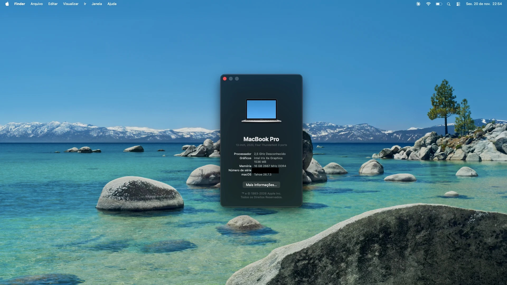

# macOS Tahoe no Dell Inspiron 15 3520 (i5-1235U, Iris Xe)

[English](README.md) · **Português**

Scripts de montagem do OpenCore e notas para rodar o macOS Tahoe 26 no Dell Inspiron 15 3520 com
Intel Core i5-1235U (Alder Lake-U, Iris Xe `8086:46a8`). Cobre aceleração de vídeo, Wi-Fi,
Bluetooth, áudio, teclado, touchpad e HDMI.

O repositório não contém binários. Um script baixa cada componente da fonte oficial, numa versão
fixa, e confere o SHA-256 (veja o [`components.lock`](components.lock)). Outro script monta a
pasta EFI a partir desses arquivos.



*O "Sobre este Mac" no notebook testado. O número de série é gerado pelo OpenCore e foi coberto
na imagem. O "Desconhecido" no processador é só cosmético: o macOS não tem nome para esta CPU.*

> [!WARNING]
> Configuração experimental, testada em **um** notebook. Várias partes dependem de drivers que
> os próprios autores chamam de experimentais. Faça backup dos seus dados antes de começar.

## Status

Testado no macOS Tahoe 26.7.3 (25G342), OpenCore 1.0.8 e BIOS Dell 1.30.0.

| Componente | Hardware | Solução | Status |
|---|---|---|---|
| CPU | i5-1235U (2 núcleos P + 8 E) | CpuTopologyRebuild, emulação de CPUID | ✅ |
| Vídeo | Iris Xe 80 EU `8086:46a8` | WhateverXe 0.8.3 + WhateverXe-Graphics 0.4.4 + AMFIAnchor | ✅ Metal 2, 1536 MB, tela interna 1080p |
| Brilho | backlight eDP | `SSDT-PNLF` dentro do iGPU + BrightnessKeys | ⚠️ funciona pela Central de Controle; Fn+F6/F7 não |
| HDMI | porta HDMI nativa | WhateverXe + override de EDID ([`edid-force-rgb.py`](scripts/edid-force-rgb.py)) | ✅ 1080p60 numa TV (precisou do override) |
| Áudio | Cirrus Logic CS8409 `1013:8409` | CS8409Audio 1.1.0 | ✅ alto-falantes e microfone · ❌ entrada de fone (P2) |
| Wi-Fi | Realtek RTL8821CE `10ec:c821` | RTL88WiFi | ✅ WPA2 · ❌ AirDrop, Continuidade, só-WPA3 |
| Bluetooth | Realtek USB `0bda:c829` | RealtekBluetoothFirmware 1.0.2 + patch, BlueToolFixup | ✅ fone pareado (A2DP, HFP, AVRCP) |
| Teclado | PS/2, ABNT2 (ISO) | VoodooPS2 com layout ISO | ✅ teclas de volume e mute funcionam |
| Touchpad | Goodix I2C `27C6:0D43` | VoodooI2C (build do master) + VoodooI2CHID | ✅ |
| Armazenamento | NVMe ADATA | NVMeFix | ✅ |
| Bateria | Dell PG8YJ3A | SMCBatteryManager, ECEnabler | ✅ nível de carga, descarga, saúde |
| USB | — | USBToolBox + mapa de portas do Inspiron 3520 | ✅ |
| Repouso, webcam | — | — | ❓ ainda não testado |

A lista completa do que foi alterado, e por quê, está em [docs/pt-BR/NOTAS.md](docs/pt-BR/NOTAS.md).

## Começo rápido

Você precisa de um Mac, um Linux ou outra máquina com `bash`, `curl`, `git`, `unzip` e `python3`,
e de um pendrive de 4 GB ou mais.

```bash
git clone https://github.com/lucaseduardo1656/dell-inspiron-3520-hackintosh
cd dell-inspiron-3520-hackintosh
scripts/fetch-components.sh --recovery   # componentes + recuperação do macOS Tahoe (~1 GB)
VERBOSE_BOOT=1 python3 scripts/build-efi.py
```

Depois siga o [guia de instalação](docs/pt-BR/INSTALACAO.md): BIOS, pendrive, instalação e os
passos dentro do macOS. Se algo falhar, veja a
[solução de problemas](docs/pt-BR/SOLUCAO-DE-PROBLEMAS.md).

## Organização do repositório

| Caminho | Conteúdo |
|---|---|
| `components.lock` | cada componente baixado: fonte, versão e SHA-256 |
| `scripts/fetch-components.sh` | baixa e confere os componentes em `downloads/` |
| `scripts/build-efi.py` | monta a `build/EFI` e documenta cada mudança no template |
| `scripts/build-bluetooth.sh` | compila o kext de Bluetooth com o patch (só no macOS) |
| `scripts/make-usb-linux.sh` | grava o pendrive de instalação a partir do Linux |
| `scripts/edid-force-rgb.py` | override de EDID para TVs e monitores HDMI com cores erradas |
| `docs/` | guia de instalação, solução de problemas e notas técnicas |

As pastas `downloads/`, `build/` e `private/` são criadas localmente e não fazem parte do
repositório. O `private/smbios.plist` guarda o número de série gerado para você: mantenha esse
arquivo e nunca o publique.

## Créditos

Esta configuração existe graças ao trabalho de outras pessoas. Ela parte do template, das
tabelas ACPI, do mapa USB e do patch de Bluetooth que
[pedrovrs301-gif](https://github.com/pedrovrs301-gif/dell-inspiron-3520-i5-1235u-sequoia)
publicou para este mesmo notebook no Sequoia. A correção do brilho vem da EFI do IdeaPad 3 de
[Aniket601](https://github.com/Aniket601/AlderLake-IrisXe-OpenCore), e o suporte de vídeo, do
WhateverXe de [b00t0x](https://github.com/b00t0x/WhateverXe).

O [CREDITS.md](CREDITS.md), em inglês, lista cada projeto, a licença de cada um e as discussões
(issues) que ajudaram a resolver problemas específicos.

## Licença

Os scripts e a documentação deste repositório estão sob a [licença MIT](LICENSE). Os
componentes baixados por eles mantêm as próprias licenças (veja o [CREDITS.md](CREDITS.md)).

## Sobre esta documentação

A documentação deste repositório foi escrita com a ajuda de IA.
